# Architecture Report

## Repository Information

**Repository Name:** MNJ

**Technology Stack:**

- Node.js
- React

---

## Executive Summary

[//]: # (summary:start)

Landing del Ministerio Nacional de Jóvenes: hero, eventos, ministerios, recursos y contacto. Hoy es una demo estática; está pensada para mostrar contenido publicado desde un sistema de administración aparte.

The model of Sitio MNJ (landing pública) describes 1 container, 1 external system, 2 people, 3 relationships and 3 key flows.

[//]: # (summary:end)

The automated dependency checks found no structural concerns.

---

[//]: # (c4:start)

## Architecture overview

El repositorio es una demo de la landing del Ministerio Nacional de Jóvenes: una SPA de React y Vite sin backend donde hero, eventos, ministerios y recursos están escritos a mano en `src/data/content.ts`. El objetivo es que un sistema de administración aparte controle el hero, los eventos (con inscripción) y los recursos para otras iglesias. Esa conexión hoy es solo una nota del README. El diagrama modela el estado actual y marca como suposición todo lo que viene de ese objetivo; la propuesta detallada está en ArchitectureReview.md.

### Findings

- Hero, eventos y recursos están fijos en el código (`src/data/content.ts:75`, `src/data/content.ts:114`, `src/data/content.ts:141`): cambiar un anuncio exige modificar el código y volver a desplegar.
- El hero solo tiene imagen, textos y un destino (`src/data/content.ts:114-139`): no existe un campo para colores ni para elegir la estructura, que son parte del requisito.
- El HTML publicado solo contiene el div raíz (`index.html:9`): sin JavaScript no hay contenido, y los enlaces compartidos en redes no tendrían vista previa por evento.
- Eventos y recursos se abren en modales sin URL propia (`src/App.tsx:26`, `src/App.tsx:177`): no se puede compartir ni indexar un evento concreto.
- El formulario no envía nada (`src/components/ContactForm.tsx:25`): no hay una inscripción real ni un destino definido para los datos.
- La conexión con un CMS es solo una nota (`README.md:65`): no hay contrato de datos ni de autenticación entre el sitio y el sistema aparte.

### Recommendations

- Pasar a Astro con islas de React y publicar `/eventos/[slug]` y `/recursos/[slug]` como páginas propias, para resolver los hallazgos de HTML vacío y de modales sin URL.
- Definir un contrato de contenido tipado (hero, evento, recurso) con zod y OpenAPI, y que el sitio lo lea en el build en vez de importar `content.ts`.
- Definir el endpoint de inscripciones en el sistema aparte, con id generado en el cliente, validación de Origin, límite de tasa y captcha, y conectarlo al formulario.

## Architecture (C4 model)

Landing del Ministerio Nacional de Jóvenes: hero, eventos, ministerios, recursos y contacto. Hoy es una demo estática; está pensada para mostrar contenido publicado desde un sistema de administración aparte.

### Diagram key

What the shapes and lines in the diagrams below mean.

| Symbol | Meaning |
|---|---|
| Dark blue rounded box | **Person** — a user or a role outside the system. |
| Blue box (Level 1) | **Software system** — the system this report describes. |
| Blue box | **Container** — an application or service that runs on its own. |
| Light blue box | **Component** — a module, package or namespace inside one container. |
| Grey box | **External system** — run by someone else. |
| Dashed grey outline | The system or the container the diagram is about. |
| Solid arrow | A dependency or a call, labelled with what it does and the technology it uses. |

### Level 1: System context

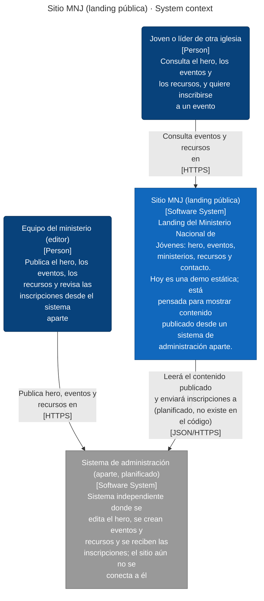

### Level 2: Containers

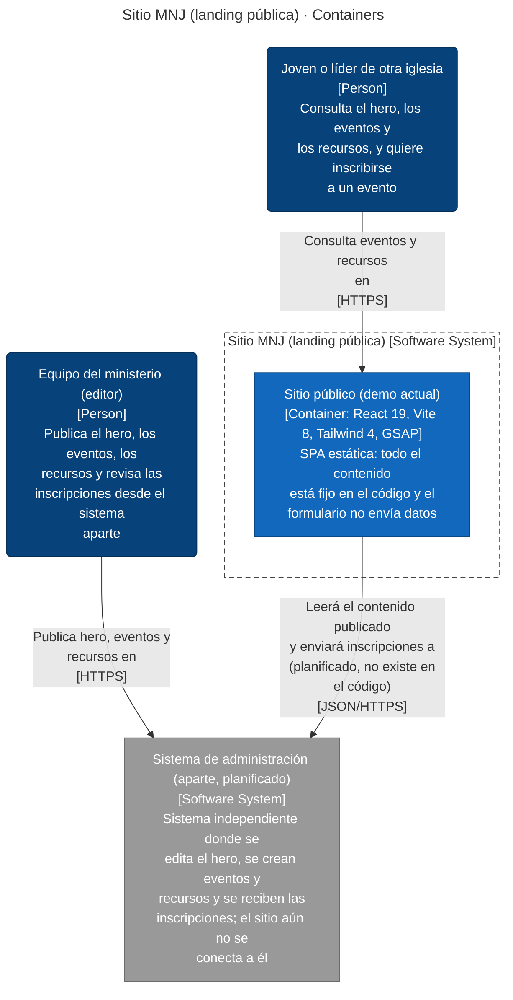

| Container | Technology | Responsibility | Code |
|---|---|---|---|
| **Sitio público (demo actual)** (container) | React 19, Vite 8, Tailwind 4, GSAP | SPA estática: todo el contenido está fijo en el código y el formulario no envía datos | `.` |

### Level 3: Components

For each container: the modules it is built from (when it has several), then the code structure inside them (packages or namespaces and the imports between them).

#### Sitio público (demo actual)

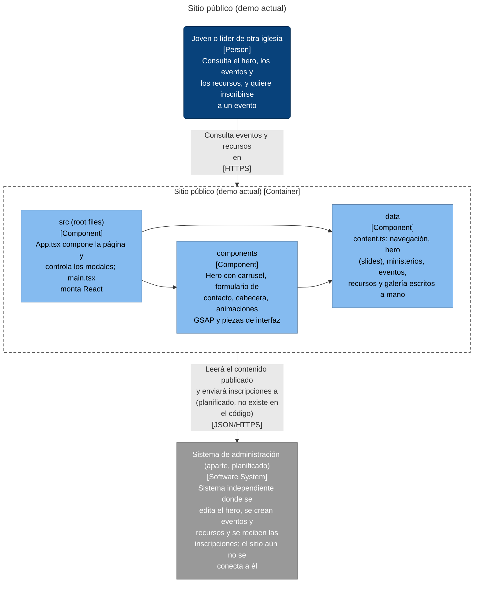

### Key flows

How a request moves through the system, step by step.

#### El visitante abre la landing

Del HTML vacío a la página pintada con hero, eventos y recursos fijos en el código.

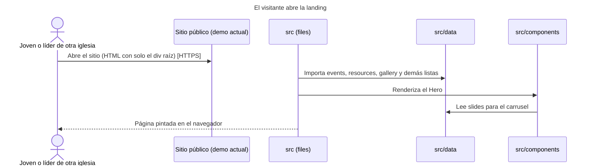

##### Scenario: La página carga

Given: el JavaScript se descarga y ejecuta

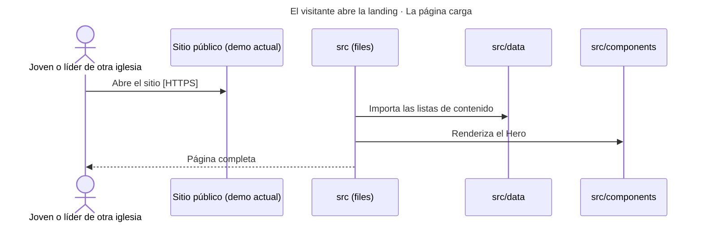

##### Scenario: El JavaScript no carga

Given: falla el bundle, hay JS desactivado o el rastreador de una red social no lo ejecuta

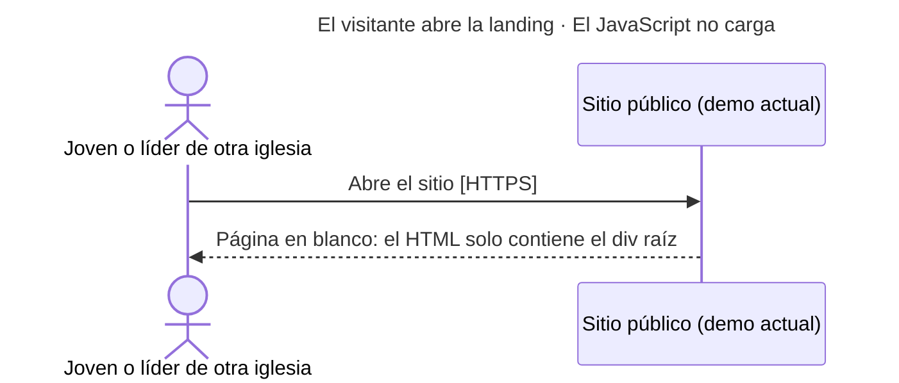

#### El visitante envía el formulario de contacto (demo)

El envío no sale del navegador: solo cambia un estado local.

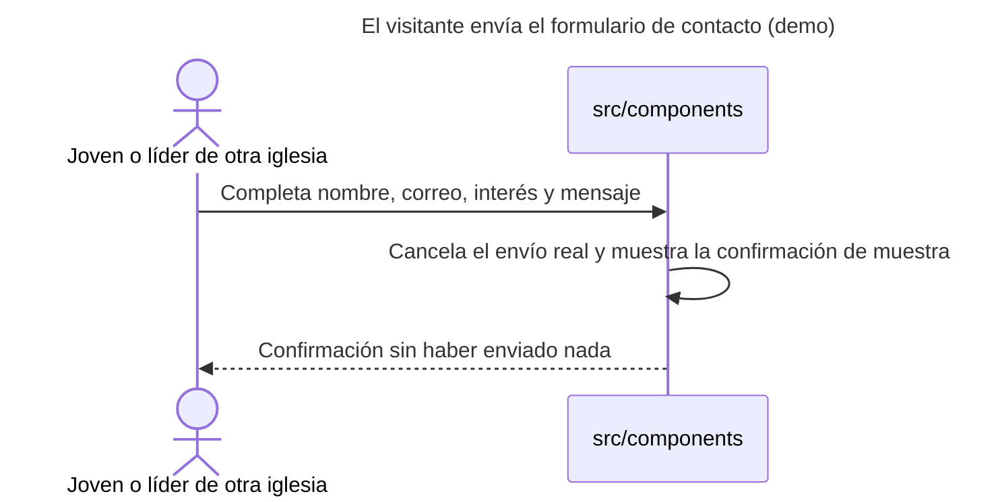

##### Scenario: Formulario válido

Given: todos los campos requeridos están completos

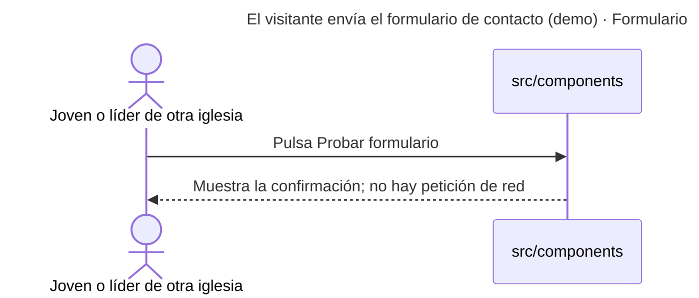

##### Scenario: Campo requerido vacío

Given: falta un campo con required

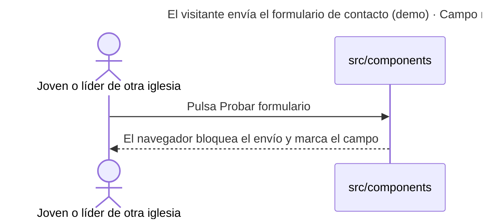

#### Inscripción a un evento (planificada, no implementada)

Flujo objetivo descrito por el usuario: el sitio lee los eventos del sistema aparte y le envía las inscripciones.

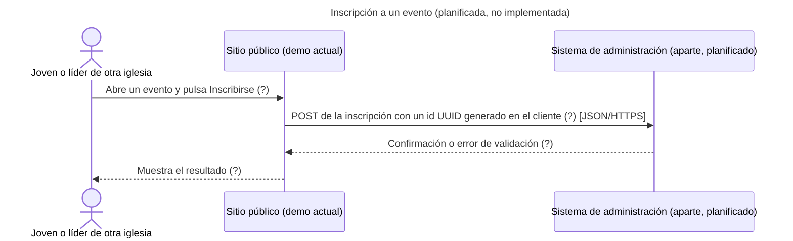

##### Scenario: Inscripción registrada

Given: el evento está abierto y hay cupo

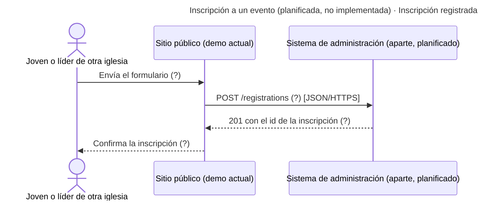

##### Scenario: Evento sin cupo o cerrado

Given: el evento se cerró entre la carga de la página y el envío

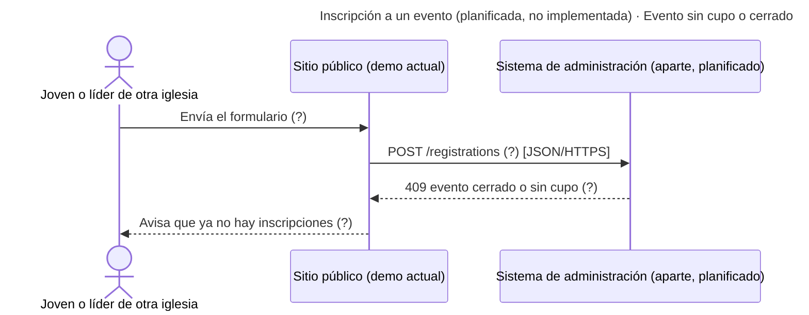

### Configuration

| Variable | Default | Used by | Declared in |
|---|---|---|---|
| `CI` | — | Sitio público (demo actual) | `playwright.config.ts:21` |

### Technology inventory

Runtime, frameworks and key libraries declared in each container's build files.

| Container | Declared |
|---|---|
| **Sitio público (demo actual)** | `@fontsource/montserrat ^5.3.0`, `@tailwindcss/vite ^4.3.3`, `gsap ^3.13.0`, `lucide-react ^1.61.0`, `react ^19.3.1`, `react-dom ^19.3.1`, `tailwindcss ^4.3.3`, `@playwright/test ^1.64.1`, `typescript ~6.0.3`, `vite ^8.3.4` |

### Assumptions

Not backed by code evidence; confirm with the team:

- **Joven o líder de otra iglesia**: Consulta el hero, los eventos y los recursos, y quiere inscribirse a un evento
- **Equipo del ministerio (editor)**: Publica el hero, los eventos, los recursos y revisa las inscripciones desde el sistema aparte
- **Sistema de administración (aparte, planificado)**: Sistema independiente donde se edita el hero, se crean eventos y recursos y se reciben las inscripciones; el sitio aún no se conecta a él
- **visitante → mnj**: Consulta eventos y recursos en
- **editor → ext-sistema-admin**: Publica hero, eventos y recursos en
- **mnj → ext-sistema-admin**: Leerá el contenido publicado y enviará inscripciones a (planificado, no existe en el código)
- **Inscripción a un evento (planificada, no implementada)** (key flow): Flujo objetivo descrito por el usuario: el sitio lee los eventos del sistema aparte y le envía las inscripciones.
- **Inscripción a un evento (planificada, no implementada) · Inscripción registrada** (scenario): el evento está abierto y hay cupo
- **Inscripción a un evento (planificada, no implementada) · Evento sin cupo o cerrado** (scenario): el evento se cerró entre la carga de la página y el envío

### C4 files

- [c4-context.mmd](c4-context.mmd)
- [c4-container.mmd](c4-container.mmd)
- [c4-component-mnj.mmd](c4-component-mnj.mmd)
- [c4-flow-carga-landing.mmd](c4-flow-carga-landing.mmd)
- [c4-flow-formulario-contacto.mmd](c4-flow-formulario-contacto.mmd)
- [c4-flow-inscripcion-evento-planificada.mmd](c4-flow-inscripcion-evento-planificada.mmd)
- [c4-facts.json](c4-facts.json)
- [c4-model.json](c4-model.json)

[//]: # (c4:end)

---

## Architectural Observations

### Strengths

[//]: # (strengths:start)

- Every container, data store and external system found in the code is in the model.
- Every container says what it is responsible for.
- Every component says what it does.
- The model names who the system is for: Joven o líder de otra iglesia and Equipo del ministerio (editor).
- 3 key flows are written down end to end: El visitante abre la landing, El visitante envía el formulario de contacto (demo) and Inscripción a un evento (planificada, no implementada).
- No circular project references.

[//]: # (strengths:end)

### Concerns

No automated concerns detected.

---

## Recommendations

No changes recommended from the automated checks. Review the diagram for boundaries the checks cannot see.

---

## Appendix: Project Dependency Graph

Every project or module and every reference between them, tests included. The automated checks above (cycles, stray projects, untested projects) are based on this graph.

**Solutions / build roots:** none found

**Project folders:** none

Full dependency graph

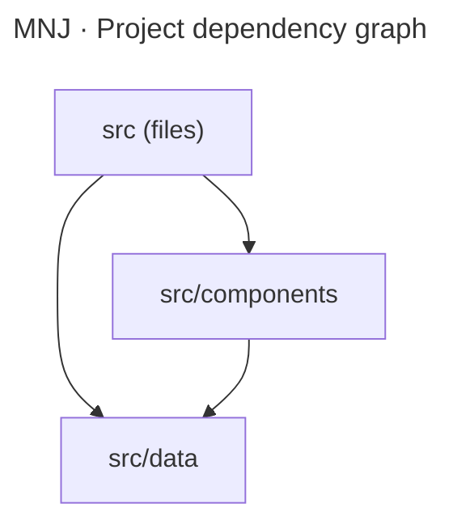

### Components

| Project | Ecosystem | Folder | Kind | Depends on | Used by |
|---|---|---|---|---|---|
| src (files) | Node.js | - | production | 2 | 0 |
| src/components | Node.js | - | production | 1 | 1 |
| src/data | Node.js | - | production | 0 | 2 |

### Dependency Analysis

### src (files)
- depends on src/components
- depends on src/data

### src/components
- depends on src/data
- used by src (files)

### src/data
- no project references
- used by src (files), src/components

---

## Generated Artifacts

- C4 diagrams: listed under Architecture (C4 model) above
- [Mermaid source](dependency-graph.mmd)
- [Dependency data (JSON)](dependency-graph.json)
- [Repository scan (JSON)](repository-scan.json)
- [Summary (JSON)](summary.json)

---

## Report Metadata

- Generated By: architecture-skills plugin, c4-diagrams skill
- Generator Version: 3.7.0
- Source: https://github.com/ythalorossy/architecture-skills

