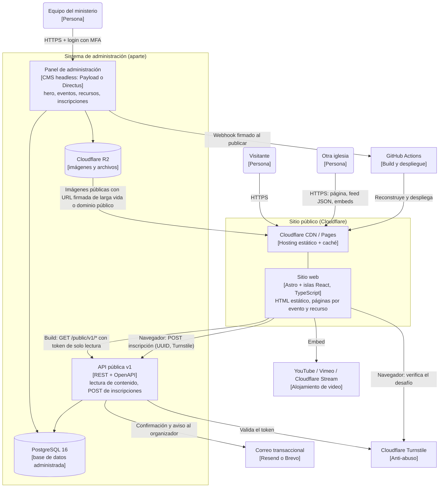
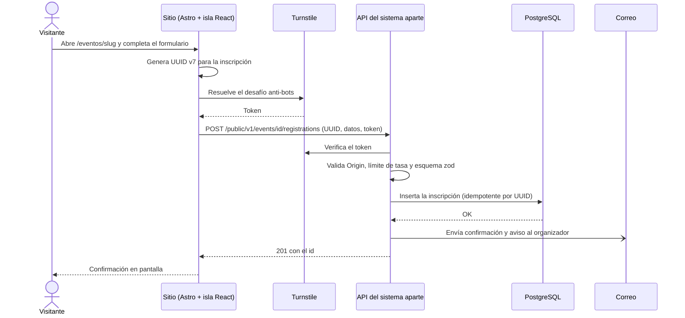

# Architecture Review: MNJ

**Date:** 2026-11-09 · **Inputs:** c4-facts.json, c4-model.json, review-evidence.json, README.md, package.json, index.html, playwright.config.ts, src/App.tsx, src/data/content.ts, src/components/Hero.tsx, src/components/ContactForm.tsx

## Executive summary

MNJ es hoy una demo estática de la landing del Ministerio Nacional de Jóvenes: una SPA de React y Vite sin backend, con todo el contenido escrito en `src/data/content.ts`. La demo está bien hecha como propuesta visual, pero su arquitectura no puede cumplir el objetivo real: que un sistema aparte controle el hero, los eventos con inscripción y los recursos para otras iglesias. Las tres acciones que más importan son: (1) definir el contrato de contenido y de inscripciones entre el sitio y el sistema de administración antes de escribir código, (2) pasar el sitio a Astro con islas de React, con HTML real y una URL por evento y por recurso, y (3) diseñar la recepción de inscripciones como un flujo de datos personales de jóvenes, con consentimiento, protección contra abuso y retención definida. La propuesta completa (lenguajes, despliegue, bases de datos y comunicación) está en la sección "Arquitectura objetivo propuesta".

## Goals and quality attributes

Los objetivos vienen de lo que el responsable del proyecto describió en la conversación, salvo donde se indica otra fuente.

- **Contenido editable sin tocar código** (hero con estructura, imagen, descripción y colores; eventos; recursos). Origen: descripción del usuario. Es el objetivo principal.
- **Inscripción a eventos** con los datos recibidos en el sistema aparte. Origen: descripción del usuario.
- **Recursos (videos, guías y más) para otras iglesias de la comunidad.** Origen: descripción del usuario.
- **Que las personas se enteren de anuncios y eventos**: enlaces compartibles y con vista previa en WhatsApp y redes (inferido: es el propósito de un sitio de anuncios).
- **Seguridad y privacidad de los datos personales de jóvenes** (inferido: público objetivo del ministerio; el sitio está dirigido a jóvenes, algunos posiblemente menores).
- **Cambiabilidad y bajo costo operativo**, porque lo mantiene un equipo pequeño (inferido).
- **Disponibilidad del sitio público aunque el sistema de administración esté caído** (inferido; es una decisión de diseño recomendada, no un requisito dado).

## Scope and inputs

Se revisó el código del repositorio (unas 878 líneas de TypeScript en `src`, sin contar CSS), el README y la configuración de build y pruebas. El análisis C4 usó `c4-facts.json` y `c4-model.json` (diagramas en esta misma carpeta: `c4-context.mmd`, `c4-container.mmd`, `c4-component-mnj.mmd` y los `c4-flow-*.mmd`). El sistema de administración **no existe todavía**: todo lo que se dice de él es propuesta o suposición del usuario. Quedaron fuera la revisión visual y de accesibilidad, el contenido institucional y las dependencias de terceros.

## Overall architecture

Hoy hay un único contenedor: una SPA estática (React 19, Vite 8, Tailwind 4, GSAP) que no se comunica con nada. El HTML solo contiene `
` (`index.html:9`) y todo se pinta en el navegador. Hero, eventos, ministerios, recursos y galería son constantes de TypeScript (`src/data/content.ts`), y App.tsx las importa directamente (`src/App.tsx:12`). El formulario de contacto cancela el envío y muestra una confirmación local (`src/components/ContactForm.tsx:25`). No hay fronteras de confianza todavía porque no hay datos que viajen.

El README reconoce el siguiente paso: los componentes reciben contenido desde un módulo de datos que "puede sustituirse" por una capa de lectura (`README.md:65`). Es una buena separación para empezar, pero es solo una intención: no hay esquema, autenticación ni definición de quién publica qué. El C4 modela el sistema de administración como un sistema externo planificado, marcado como suposición.

## Arquitectura objetivo propuesta

Esta sección es una propuesta de diseño, no un hallazgo del código actual. Las decisiones de herramientas son las mejores a la fecha de esta revisión y deben confirmarse antes de construir (marcadas como "a decidir" donde dependen de tu equipo). Lo durable son las fronteras: contrato tipado, lectura estática, un único punto de escritura y datos personales solo en el sistema aparte.

### Visión general

### Elección de tecnologías

| Pieza | Propuesta | Por qué | Alternativa |
|---|---|---|---|
| Sitio público | **Astro** (salida estática) con **islas de React** y TypeScript estricto | HTML real por evento y recurso, buen SEO y vistas previas al compartir, JavaScript solo donde hay interacción; reutiliza tus componentes y GSAP | TanStack Start, si el sitio acaba con mucha interactividad |
| Estilos y animación | Tailwind 4 con tokens semánticos; GSAP cargado solo en las islas que lo usan (`client:idle` o `client:visible`) | Hoy GSAP y todo el sitio van en un solo bundle de unos 383 KB sin comprimir (`dist/assets/index-CmmSiFIq.js`); en Astro solo se descarga lo que se hidrata | CSS View Transitions para lo simple |
| Hosting del sitio | **Cloudflare Pages** (o Workers con assets estáticos) | CDN global, previsualizaciones por rama, costo bajo; mismo proveedor que R2 y Turnstile | Netlify o autoalojado con Nginx |
| Sistema de administración | **CMS headless en TypeScript** (a decidir: **Payload** o **Directus**) con colecciones `hero`, `events`, `resources` y `registrations` | Panel de edición, roles, borradores y programación de publicación ya resueltos; solo se construye a medida la recepción de inscripciones | Backend propio con Hono + oRPC + Drizzle + Better Auth, si necesitan lógica muy particular o un costo de licencia nulo y control total |
| Base de datos | **PostgreSQL 16 administrado** (Neon, Supabase o el del proveedor del contenedor) con copias de seguridad diarias y recuperación a un punto en el tiempo | Datos relacionales (evento ↔ inscripciones), integridad y consultas de reportes | SQLite (Turso o D1) si el volumen es muy bajo y quieren el costo mínimo |
| Archivos | **Cloudflare R2** para imágenes y PDF | Sin costo por salida de datos, S3 compatible, cerca del CDN | S3 |
| Video | **No alojar**: YouTube (no listado), Vimeo o Cloudflare Stream, incrustados por `embedId` | Evita costos de ancho de banda y transcodificación | Archivos grandes en R2 solo para descargas |
| Hosting del admin | **Contenedor Docker** en Fly.io, Railway, Render o un VPS, detrás de Cloudflare | Un CMS con panel y sesiones necesita un proceso de larga duración; no es buen candidato a funciones sin servidor | Cloudflare Workers si el backend es un Hono propio |
| Contrato | Paquete `@mnj/contracts` con esquemas **zod**, OpenAPI generado y tipos compartidos | Un solo origen de verdad; el sitio y el sistema aparte no pueden desalinearse | JSON Schema escrito a mano |
| Correo | **Resend** o **Brevo** | Confirmación al inscrito y aviso al organizador | SMTP del hosting |
| Anti-abuso | **Cloudflare Turnstile** + límite de tasa por IP y por correo | Un formulario público de inscripción atrae bots | hCaptcha |
| CI/CD | **GitHub Actions** con `npm ci`, lint, tipos, pruebas del contrato y despliegue; acciones fijadas por SHA | Hoy no hay ningún pipeline | Cloudflare Pages build nativo |
| Observabilidad | Un evento de log estructurado por petición en la API, **Sentry** gratuito para errores del navegador y de la API, y monitor de disponibilidad | Saber si una inscripción falló antes de que alguien se queje | Logs del proveedor |

**Lenguajes:** TypeScript en todo (sitio, contrato y CMS o API). Un solo lenguaje permite compartir esquemas y reduce lo que el equipo debe saber. SQL para el esquema y los reportes de inscripciones.

### Cómo se comunican los dos sistemas

El sitio y el sistema de administración son proyectos, repositorios y despliegues distintos. Solo se conocen por el contrato `v1`.

**1. Lectura de contenido (hero, eventos, recursos): estática, en el build.**

1. El editor guarda y publica un cambio en el panel.
2. El CMS envía un **webhook firmado (HMAC)** al despliegue de Cloudflare Pages o a GitHub Actions.
3. Astro reconstruye el sitio: pide `GET /public/v1/hero`, `/events` y `/resources` con un **token de solo lectura** guardado como secreto de CI (nunca en una variable `VITE_` ni en el navegador), valida las respuestas con zod y genera las páginas.
4. Cloudflare sirve el nuevo HTML. Tiempo esperado de publicación: uno o dos minutos.
5. Una reconstrucción programada cada noche cambia el estado de eventos que ya pasaron o cuyas inscripciones cerraron.
6. Si el API no responde durante el build, el build falla y el sitio anterior sigue en línea. Así el sitio público no depende de que el admin esté arriba.

Si un cambio urgente no puede esperar al build, la **fase 2** pasa las páginas de eventos y el hero a renderizado bajo demanda con caché en el borde (KV) y purga al publicar. Se decide con datos reales, no desde el día 1.

**2. Inscripciones: escritura directa del navegador al sistema aparte.**

1. El visitante abre `/eventos/<slug>` (HTML estático) y la isla de React muestra el formulario.
2. Antes de enviar, el navegador genera un **UUID v7** que será el id de la inscripción y obtiene un token de **Turnstile**.
3. El navegador hace `POST https://api.<dominio>/public/v1/events/{eventId}/registrations` con JSON validado con el mismo esquema zod del contrato. El API solo acepta `Origin` del sitio (lista de permitidos), aplica límite de tasa y verifica Turnstile en el servidor.
4. El API valida de nuevo, revisa que el evento esté abierto y tenga cupo, y guarda la inscripción en PostgreSQL. Si llega el mismo UUID otra vez, responde lo mismo que la primera vez (idempotente), así un reintento por mala señal no duplica a nadie.
5. Respuestas: `201` con el id, `409` evento cerrado o sin cupo, `422` datos inválidos, `429` demasiadas solicitudes.
6. El API encola un correo de confirmación al inscrito y un aviso al organizador. El editor ve y exporta las inscripciones (CSV) en el panel.

Si en la práctica el CORS complica la operación, se enruta `<dominio>/api/*` hacia el sistema aparte desde Cloudflare para mantener un único origen, sin añadir código intermedio.

**3. Recursos para otras iglesias.**

- Cada recurso tiene su página pública (`/recursos/<slug>`) y se publica también como feed `GET /public/v1/resources` (JSON) y RSS, para que otras iglesias lo consuman o lo enlacen.
- Los videos se incrustan desde YouTube, Vimeo o Stream; los PDF y las imágenes salen de R2.
- Fase 2: recursos de acceso restringido para iglesias registradas, con cuentas por iglesia en el sistema aparte.

**4. Autenticación y autorización.**

| Quién | Cómo | Permiso |
|---|---|---|
| Editor del ministerio | Login del CMS con MFA (SSO con Google Workspace si lo usan) | Crear y publicar contenido, ver y exportar inscripciones |
| Build del sitio | Token de solo lectura en CI | Solo `GET /public/v1/*` de contenido publicado |
| Navegador del visitante | Sin autenticación; Turnstile, límite de tasa y `Origin` | Solo `POST` de inscripciones y `GET` público |
| Otras iglesias | Sin cuenta en la fase 1; feed público | Solo lectura de recursos públicos |

Las inscripciones **nunca** se exponen por una API pública de lectura: solo el panel autenticado las muestra.

### Modelo de datos y contrato (resumen)

| Entidad | Campos principales | Reglas |
|---|---|---|
| `hero` | `variant` (enum de composiciones, p. ej. `split`, `poster`, `centered`), `image` (asset + `alt` obligatorio + punto focal), `eyebrow`, `title`, `description` (con largos máximos), `cta` (`label` + destino: evento, sección o URL permitida), `theme` (preset con nombre, o dos colores validados), `publishFrom`, `publishUntil` | El panel rechaza una combinación de colores con contraste menor a 4.5:1. No hay HTML libre. Si no hay hero publicado, el sitio usa uno por defecto |
| `event` | `id`, `slug`, `title`, `description` (texto con formato limitado y saneado), `startsAt`, `endsAt` (zona `America/Lima`), `location`, `image`, `capacity`, `registrationOpen`, `registrationDeadline`, `status` (`draft`, `published`, `cancelled`) | Una inscripción nueva se rechaza si el evento está cerrado, sin cupo o cancelado, siempre en el servidor |
| `resource` | `id`, `slug`, `type` (`video`, `pdf`, `audio`, `link`, `article`), `provider` y `embedId` o `file`, `tags`, `audience`, `publishedAt` | Solo proveedores de video permitidos; los enlaces se validan |
| `registration` | `id` (UUID v7 del cliente), `eventId`, `name`, `email`, `phone`, `church`, `guardianConsent`, `consentAt`, `createdAt` | Solo los campos necesarios; consentimiento con fecha; retención definida |

### Despliegue y entornos

- **Entornos:** desarrollo local, `staging` (sitio y admin con datos de prueba) y producción. Cada rama del sitio genera una vista previa en Cloudflare Pages que apunta al admin de `staging`.
- **Dominios:** `www.<dominio>` para el sitio y `api.<dominio>` o `admin.<dominio>` para el sistema aparte, detrás de Cloudflare con TLS y HSTS.
- **Secretos:** solo en el gestor del proveedor y en secretos de CI; el repositorio no guarda claves.
- **Cabeceras:** CSP con lista de orígenes permitidos (YouTube, Vimeo, Turnstile, R2), `X-Content-Type-Options`, `Referrer-Policy` y `frame-ancestors`.
- **Copias de seguridad:** Postgres con copia diaria y recuperación a un punto en el tiempo; R2 con versionado; prueba de restauración trimestral.

### Datos personales

El formulario de inscripción recoge nombre, correo, teléfono e iglesia de jóvenes, algunos posiblemente menores de edad. Antes de recibir datos reales conviene: aviso de privacidad y casilla de consentimiento con fecha, consentimiento del tutor para menores, retención definida (por ejemplo, borrar o anonimizar a los N meses del evento), acceso limitado a quienes organizan y registro de quién exporta. La normativa aplicable en Perú (Ley N.º 29733 de protección de datos personales) debe confirmarla alguien con criterio legal; esta revisión no la evalúa.

### Hoja de ruta sugerida

| Fase | Entrega | Resultado |
|---|---|---|
| 0 | Contrato `v1` (hero, evento, recurso, inscripción) con esquemas zod y datos de ejemplo | Ambos lados pueden trabajar en paralelo |
| 1 | Migrar el sitio a Astro, con las islas existentes y datos leídos del contrato (mock o JSON) | HTML real, páginas por evento y recurso, mejor rendimiento |
| 2 | Sistema de administración con las cuatro colecciones, roles y publicación | El equipo edita sin código |
| 3 | Webhook de publicación, reconstrucción y fallback ante fallo del API | Publicar en uno o dos minutos |
| 4 | Inscripciones reales: formulario, Turnstile, límite de tasa, idempotencia, correos y exportación | Eventos con inscripción |
| 5 | Pipeline de CI, cabeceras, monitoreo, copias de seguridad y pruebas de restauración | Operación estable |
| 6 (opcional) | Cuentas para otras iglesias y recursos restringidos; renderizado bajo demanda si la espera de build molesta | Escalar a la comunidad |

## Analysis by lens

### Security

Hoy no hay superficie de ataque real: sin backend, sin datos y sin secretos (el escaneo no encontró señales y el README lo declara). El riesgo está en lo que viene: la inscripción pública recogerá datos personales de jóvenes (F2), el hero editable podría abrir una puerta a estilos o contenido no controlados (F4) y el contrato entre sistemas no define autenticación (F5). Tampoco hay una política de cabeceras ni CSP (F6). Qué no se pudo ver: cómo gestionará el sistema aparte las sesiones, porque aún no existe.

### Data

Los datos de contenido viven en un archivo de código (F1), por lo que no hay modelo, validación ni historial de cambios. La tabla de inscripciones, su retención y su exportación son diseño pendiente (F2). La propuesta pone toda la persistencia en el sistema aparte: PostgreSQL para estructura y R2 para archivos, y deja el sitio sin estado.

### Application

El sitio es una SPA con HTML vacío (F3) y modales sin dirección propia (F3). El contenido está acoplado al código (F1) y no hay un contrato con el sistema aparte (F5). La separación en componentes y la carpeta `src/data` son una buena base, y migrar a Astro con islas conserva casi todo el trabajo visual. El hero actual no tiene campos de color ni de estructura (F4).

### Infrastructure

No hay configuración de hosting, de CI ni de contenedores: el repositorio solo tiene scripts de Vite y Playwright (F6). Las pruebas arrancan Vite en desarrollo y exigen Microsoft Edge instalado (`playwright.config.ts:11`, `playwright.config.ts:18-21`), lo que dificulta correrlas en una máquina de integración continua sin ese navegador. La propuesta de despliegue (Cloudflare para el sitio, contenedor y Postgres administrado para el admin) está en la sección de arquitectura objetivo.

## Key findings and action items

### F1: El contenido se edita en el código, no en un sistema aparte

- **Priority:** High — el requisito principal del proyecto (editar hero, eventos y recursos de forma independiente) no se puede cumplir con esta arquitectura.
- **Lens:** Application
- **Evidence:** `src/data/content.ts:75`, `src/data/content.ts:114`, `src/data/content.ts:141`, `src/App.tsx:12`
- **Scenario:** El equipo quiere promocionar un evento con un nuevo hero. Alguien debe editar `content.ts`, volver a compilar y desplegar. Quien administra el contenido no puede hacerlo sin un desarrollador, y cada anuncio urgente depende de él.
- **Fix:** Definir un contrato de contenido (esquemas zod para hero, evento y recurso) y reemplazar la importación de `content.ts` por una capa de lectura que consuma la API pública del sistema de administración durante el build. Mantener `content.ts` como datos de ejemplo para pruebas y desarrollo.
- **Tradeoff:** Hay que construir o adoptar el sistema aparte y mantener dos proyectos con un contrato versionado. A cambio, el contenido se publica sin desplegar código.
- **Confidence:** High — se leyó el código; la necesidad viene de lo que describió el usuario.

### F2: La inscripción recogerá datos personales de jóvenes sin un destino ni protección definidos

- **Priority:** Medium — hoy el formulario no envía nada, así que no hay datos en riesgo; se vuelve High en cuanto se conecte sin este diseño.
- **Lens:** Security
- **Evidence:** `src/components/ContactForm.tsx:25`, `src/components/ContactForm.tsx:27-47`, `README.md:36`
- **Scenario:** Al convertir el formulario en inscripción, un POST público a un endpoint recibirá nombre, correo y teléfono de jóvenes, algunos menores. Sin límite de tasa ni captcha, un bot puede llenar el cupo o la base con basura. Sin consentimiento ni retención definida, los datos pueden quedar guardados indefinidamente. Sin idempotencia, un reintento por mala señal duplica la inscripción.
- **Fix:** Implementar el flujo descrito en "Cómo se comunican los dos sistemas": UUID v7 generado en el cliente, Turnstile, validación de `Origin` y de esquema en el servidor, límite de tasa, cupo verificado en el servidor, consentimiento con fecha, consentimiento del tutor para menores y una política de retención. Las inscripciones solo se ven en el panel autenticado.
- **Tradeoff:** Un captcha y un consentimiento añaden fricción al formulario y trabajo de diseño; el límite de tasa puede bloquear a una iglesia entera que se inscribe desde una misma red, y hay que afinar el umbral.
- **Confidence:** Medium — el código confirma que no hay envío ni destino; el nivel de riesgo depende de qué datos se pidan finalmente y de la edad del público, que es inferida.

### F3: HTML vacío y eventos sin URL propia

- **Priority:** Medium — afecta la difusión de anuncios (el propósito del sitio) pero no rompe nada hoy.
- **Lens:** Application
- **Evidence:** `index.html:9`, `src/App.tsx:26`, `src/App.tsx:177`
- **Scenario:** Alguien comparte por WhatsApp o redes el evento "Encuentro nacional". No existe un enlace a ese evento (se abre en un modal dentro de la misma página), y el HTML que ve un rastreador de vista previa solo contiene un `div` vacío: se muestra el título genérico y ninguna imagen del evento. Quien llega con JavaScript bloqueado o con una red lenta ve una página en blanco hasta que descarga unos 383 KB de JavaScript.
- **Fix:** Migrar a Astro con salida estática: una página `/eventos/<slug>` y una `/recursos/<slug>` por elemento, con título, descripción e imagen en las etiquetas Open Graph; mantener en islas de React solo lo interactivo (carrusel, formulario, galería, animaciones). Conservar los modales solo como mejora opcional.
- **Tradeoff:** Es una migración de la estructura del proyecto (rutas, build y carga de islas) y GSAP debe reorganizarse por isla. A cambio, el contenido de los eventos es visible, indexable y compartible.
- **Confidence:** High — el HTML y el estado del modal se verificaron en el código; el efecto sobre las vistas previas es un comportamiento conocido de las SPA.

### F4: El hero actual no admite color ni estructura, y editarlos sin límites sería riesgoso

- **Priority:** Medium — es un requisito del usuario que el modelo actual no cubre, y un diseño sin límites generaría un riesgo después.
- **Lens:** Application
- **Evidence:** `src/data/content.ts:114-139`, `src/components/Hero.tsx:44-63`
- **Scenario:** Un editor promociona un evento y elige colores o textos que dejan el titular ilegible en móvil, o pega HTML o estilos desde otra fuente. Hoy el hero solo tiene imagen, textos y un destino fijo; si el nuevo sistema envía colores y estructura libres, el sitio publicará lo que reciba, incluso si rompe la accesibilidad o el diseño.
- **Fix:** Modelar el hero como un conjunto cerrado: variantes de composición predefinidas, temas por preset con nombre o dos colores validados por contraste, imagen con `alt` obligatorio, largos máximos, fechas de publicación y un hero por defecto. El sitio valida con zod y nunca inserta HTML recibido.
- **Tradeoff:** Menos libertad creativa para el editor; a cambio, cualquier combinación publicable es legible, segura y coherente con la marca.
- **Confidence:** Medium — la forma del hero actual está verificada; la forma exacta del tema y sus límites es una propuesta que el equipo debe validar con diseño.

### F5: No hay contrato, autenticación ni modo de fallo definidos entre el sitio y el sistema aparte

- **Priority:** Medium — es la decisión de mayor coste de cambio y todavía no está tomada.
- **Lens:** Application
- **Evidence:** `README.md:65`, `src/data/content.ts:1`, `package.json:13-22`
- **Scenario:** Cada equipo construye su lado por separado. El sistema aparte cambia el nombre de un campo y el sitio publica una página rota, o el token de lectura queda en el navegador porque se usó una variable pública. Si el sistema aparte cae durante una publicación, el sitio podría quedar vacío si cada visita consulta el API en vivo.
- **Fix:** Escribir primero el contrato `v1` como paquete compartido (zod y OpenAPI), versionado, con pruebas de contrato en CI de ambos lados. El sitio lee en el build con un token de solo lectura en un secreto de CI y, si el API falla, el build falla y se conserva la versión anterior en línea. El sistema aparte firma sus webhooks.
- **Tradeoff:** Requiere disciplina de versionado y coordinar cambios entre dos proyectos; un cambio de campo ya no es instantáneo. A cambio, ambos proyectos evolucionan sin romperse.
- **Confidence:** High — el README solo describe la intención y ningún archivo la implementa.

### F6: Sin despliegue, integración continua ni cabeceras de seguridad definidas

- **Priority:** Low — es una demo y no hay datos; pasa a ser necesario antes de publicar.
- **Lens:** Infrastructure
- **Evidence:** `index.html:4-7`, `playwright.config.ts:11`, `playwright.config.ts:18-21`, `package.json:6-11`
- **Scenario:** Al publicar, no hay un pipeline que ejecute lint, tipos y pruebas, ni configuración de hosting, ni CSP ni cabeceras (en `index.html:4-7` no hay política de seguridad de contenido; las cabeceras irían en el hosting). Las pruebas dependen de Microsoft Edge instalado y del servidor de desarrollo, así que correrlas en una máquina limpia de CI exige instalar ese navegador. Una dependencia nueva puede entrar sin revisión.
- **Fix:** Crear un workflow de GitHub Actions con `npm ci`, `npm run lint`, `npm run build` y pruebas (instalando el navegador de Playwright en el job), desplegar a Cloudflare Pages con vista previa por rama, añadir cabeceras y CSP en el hosting, y fijar las versiones de las acciones.
- **Tradeoff:** Algo de tiempo de configuración y minutos de CI; la CSP estricta exige listar los orígenes de video y captcha.
- **Confidence:** Medium — la ausencia de archivos de CI y hosting es una búsqueda en el repositorio, no una prueba; el equipo puede tenerlos fuera de este repositorio.

## Action plan

| Order | Action | Findings | Effort |
|---|---|---|---|
| 1 | Escribir el contrato `v1` (hero, evento, recurso, inscripción) con zod y OpenAPI, y decidir CMS o backend propio | F1, F4, F5 | Días |
| 2 | Migrar el sitio a Astro con islas de React, páginas por evento y recurso y lectura desde el contrato | F1, F3 | 1–2 semanas |
| 3 | Construir el sistema de administración con las cuatro colecciones y la publicación con webhook | F1, F4, F5 | 1–3 semanas |
| 4 | Implementar inscripciones con Turnstile, idempotencia, límite de tasa, consentimiento y correos | F2 | 1 semana |
| 5 | Pipeline de CI y despliegue, cabeceras y CSP, monitoreo y copias de seguridad | F6 | Días |

## What I inspected and what I did not

**Inspeccionado:** `index.html`, `package.json`, `README.md`, `playwright.config.ts`, `src/App.tsx`, `src/data/content.ts`, `src/components/Hero.tsx`, `src/components/ContactForm.tsx`, el tamaño del bundle en `dist/assets`, la lista de archivos del repositorio y las salidas `c4-facts.json` y `c4-model.json`. El escaneo automático no produjo señales (cero), y se confirmó leyendo el código que no hay secretos, llamadas de red ni almacenamiento local en el código de la aplicación.

**No inspeccionado:** `src/components/Header.tsx`, `src/components/MotionExperience.tsx`, `src/components/ui.tsx`, los archivos CSS y `tests/frontend.spec.ts` en detalle; la accesibilidad y el rendimiento reales en un móvil de gama baja; el contenido institucional y las licencias de las imágenes; y todo el sistema de administración, que no existe. Una revisión estática no ve el comportamiento en ejecución, el hosting real ni lo listado en `not_checked` del archivo de evidencia.

**Suposiciones:** el público incluye menores de edad; el equipo es pequeño; el sistema aparte lo construirá o adoptará el propio equipo. Las elecciones de CMS, proveedor de base de datos y hosting del admin son propuestas a decidir según presupuesto y habilidades del equipo. Las referencias a la normativa peruana de datos personales requieren validación legal. No se generaron los SVG de los diagramas porque falló la herramienta de renderizado (`npx` con mermaid-cli); los diagramas están en formato Mermaid (`.mmd`).

## Report Metadata

- Generated By: architecture-skills plugin, architecture-review skill
- Generator Version: 3.7.0
- Source: https://github.com/ythalorossy/architecture-skills
